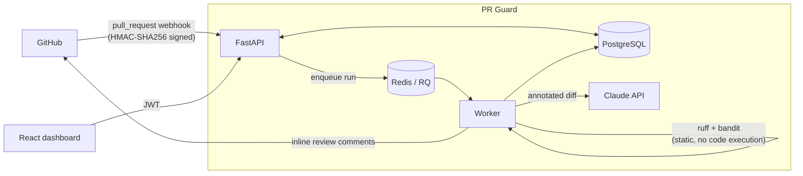

# PR Guard

AI-assisted code review for GitHub pull requests. When a PR is opened or updated, PR Guard runs
static analysis (Ruff, Bandit) and an LLM review pass on the changed lines, posts the findings back
to the PR as inline review comments, and keeps a history you can filter and trend on a dashboard.

**Stack:** Python · FastAPI · PostgreSQL · SQLAlchemy 2 · Alembic · Redis · RQ · Claude API · React · TypeScript · Docker · GitHub Actions

## Architecture



1. **Webhook** (`POST /api/webhooks/github`) verifies the signature over the raw body, upserts the PR,
   and creates a `ReviewRun` keyed on `(pull_request, head_sha)`. Redelivered webhooks hit that unique
   key and become no-ops.
2. **Worker** fetches the changed files at the PR's head commit, runs Ruff and Bandit on the Python
   files and sends every text diff to the LLM, annotated with new-file line numbers.
3. Findings are **filtered to the lines the PR added**, de-duplicated across tools (Ruff `S602` and
   Bandit `B602` are the same check), sorted by severity, saved, and posted as one GitHub review.
4. The **dashboard** shows severity totals, a findings-per-day chart, and a filterable, paginated table.

## Features

- **Auth & RBAC:** JWT bearer tokens, bcrypt hashes, three roles (`viewer` < `reviewer` < `admin`).
  The role is read from the database on each request, so a demotion takes effect immediately.
- **Login rate limiting:** a fixed window per IP held in Redis, so the limit holds across API replicas.
- **Idempotent webhooks:** a unique constraint on `(pull_request_id, head_sha)`.
- **Async processing:** reviews run on an RQ worker. If the queue is down, the run is marked `failed`
  rather than stuck in `queued`, and it can be re-run from the API.
- **LLM review with structured output:** responses are constrained to a JSON schema and validated
  with Pydantic. The model is told the diff is untrusted, so instructions planted in a PR are reviewed,
  not obeyed. Refusals, truncation and API errors produce a note on the run instead of failing it.
- **Secret scanning on every file type:** a diff-based scanner flags provider keys (AWS, GitHub,
  Stripe, Slack, Google, Anthropic, private keys) as critical and secret-looking assignments
  (`API_KEY = "..."`, `DB_PASSWORD=...`) in Python, JS, YAML, JSON and `.env` files as high. It skips
  placeholders and environment lookups, and masks the value in its comment.
- **Safe handling of untrusted code:** analyzers only parse files, never import or execute them.
  File paths are checked for `..` and absolute paths. The container runs as a non-root user.
- **Resilient posting:** findings are committed before the GitHub review is posted. If GitHub rejects
  inline comments (stale lines), it falls back to a summary review.

## Quick start

```bash
cp .env.example .env        # fill in the secrets
docker compose up --build
```

- Dashboard: http://localhost:8088 (the first account you register becomes admin)
- API docs (OpenAPI): http://localhost:8000/api/docs

### Try it offline, at zero cost

No GitHub token or API key is needed. This runs the real review pipeline on three sample pull
requests and fills the dashboard:

```bash
docker compose exec api python -m app.demo
```

If `DEMO_ADMIN_EMAIL` and `DEMO_ADMIN_PASSWORD` are set in `.env`, it also creates that admin account.

**Cost:** everything runs free by default. The Claude review pass is opt-in
(`LLM_REVIEW_ENABLED=true` plus `ANTHROPIC_API_KEY`) and is billed per use by Anthropic.

### Connect a repository

1. Register the repo on the dashboard (admin only), as `owner/repo`.
2. In the repo on GitHub: **Settings → Webhooks → Add webhook**
   - Payload URL: `https://<your-host>/api/webhooks/github`
   - Content type: `application/json`
   - Secret: the value of `GITHUB_WEBHOOK_SECRET`
   - Events: **Pull requests**
3. Set `GITHUB_TOKEN` to a fine-grained token with *Pull requests: read & write* and *Contents: read*.

For local testing, expose port 8000 with a tunnel (e.g. `ngrok http 8000`) and use that URL.

## Local development

```bash
# Backend
cd backend
python -m venv .venv && .venv/bin/pip install -r requirements-dev.txt   # Windows: .venv\Scripts\
docker compose up -d db redis        # from the repo root
alembic upgrade head
uvicorn app.main:app --reload
rq worker reviews                    # in a second terminal

# Frontend (proxies /api to :8000)
cd frontend && npm install && npm run dev
```

## Testing

```bash
cd backend
pytest                 # 51 tests, coverage gate at 85% (currently ~97%)
ruff check . && ruff format --check .
```

The tests cover auth (tampered and expired tokens, rate limiting, uniform login errors), RBAC,
webhook signatures and idempotency, diff parsing, real Ruff and Bandit runs, the review pipeline
end to end with fake GitHub and LLM clients, LLM failure modes, the GitHub client via
`httpx.MockTransport`, and **a check that the Alembic migrations match the models**. CI also
applies the migrations to a real Postgres.

## API

| Method | Path | Role |
|---|---|---|
| POST | `/api/auth/register`, `/api/auth/login` | public (login rate-limited) |
| GET | `/api/auth/me` | any |
| PATCH | `/api/auth/users/{id}/role` | admin |
| GET / POST | `/api/repos` | any / admin |
| GET | `/api/repos/{id}/pulls` | any |
| GET | `/api/runs/{id}` | any |
| POST | `/api/runs/{id}/rerun` | reviewer |
| GET | `/api/findings?repo_id&severity&tool&limit&offset` | any |
| GET | `/api/stats/trends?repo_id&days` | any |
| POST | `/api/webhooks/github` | GitHub signature |

## Design decisions

- **RQ over Celery:** one queue and one job type don't need Celery's broker abstraction or beat
  scheduler. RQ is a few lines of setup and is easy to inspect in Redis.
- **Enums stored as VARCHAR + CHECK** (`native_enum=False`): adding a severity or status is a
  plain migration, with no Postgres `ALTER TYPE`.
- **Index `(severity, created_at)` on findings:** it serves both the dashboard's
  "filter by severity, newest first" query and the trend aggregation.
- **Trend query is a single `GROUP BY date, severity`:** the chart costs one query regardless of range.
- **Only added lines are reviewed:** flagging pre-existing code in a PR trains people to ignore the bot.
- **Oversized diffs are skipped, not truncated:** a truncated diff produces confident findings
  about code the model never saw. Skipped files are listed in the review summary.

## Deploying on AWS

A straightforward setup: **ECS Fargate** services for `api`, `worker` and `web` (the same images as
compose), **RDS PostgreSQL**, **ElastiCache Redis**, secrets in **Secrets Manager** injected as env
vars, and an **ALB** routing `/api/*` to the API. Point the GitHub webhook at the ALB's HTTPS URL.
